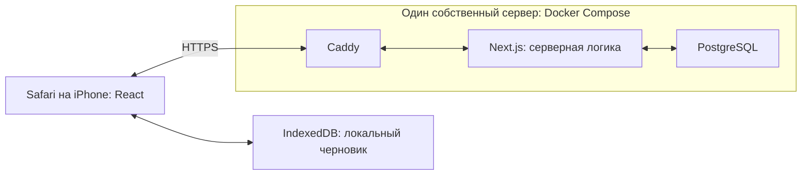
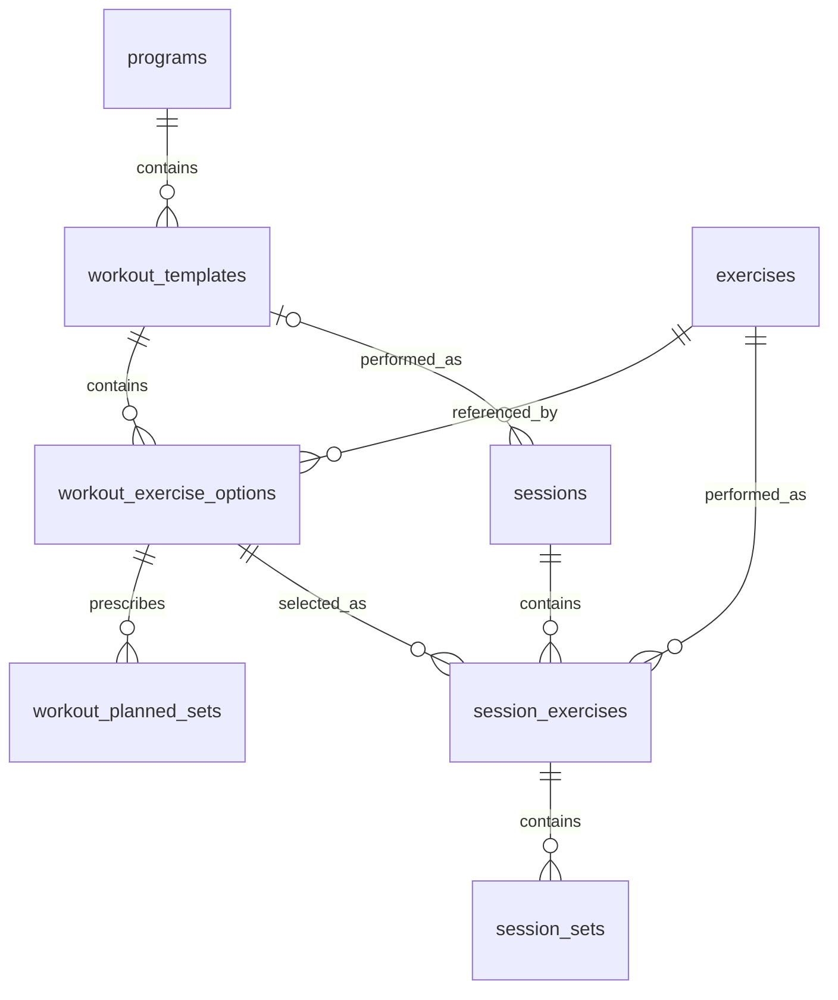

# Train Club — согласованная архитектура

Актуализировано: 8 ноября 2026 года.

Документ собирает решения из обсуждения архитектуры с учётом последних уточнений: приложение только для одного человека, без аутентификации и авторизации; PostgreSQL без JSONB; восемь таблиц; локальное автосохранение через IndexedDB входит в первую версию.

Бизнес-требования: [REQUIREMENTS.md](REQUIREMENTS.md). Визуальный образец: [прототип](design/index.html) и [его описание](design/README.md).

Статус: версия 0.1.0 развёрнута на собственном сервере Hoster.kz. Next.js, PostgreSQL 17 и Caddy работают через Docker Compose; загружена персональная программа A/B. Проверены HTTPS, сохранение и редактирование, браузерные сценарии и восстановление резервной копии. Источник DDL — db/migrations/; инструкция эксплуатации — [ops/DEPLOYMENT.md](ops/DEPLOYMENT.md).

## 1. Назначение и границы

- Личный дневник тренировок для одного человека.
- Мобильный веб-интерфейс для Safari на iPhone 17; установка приложения не требуется.
- Виды занятий: зал, бокс и пилатес.
- Зал проходит по повторяющемуся блоку из восьми тренировок строго по очереди.
- Программу и допустимые замены согласуют с тренером и загружают через SQL.
- Пользователь записывает результаты, просматривает историю и исправляет внесённые данные.
- Пользователей, ролей, регистрации, входа и разграничения доступа нет. Supabase Auth не используется.
- При публикации в интернете любой, кто получит адрес приложения, сможет читать и изменять дневник через приложение. Секреты подключения к базе остаются на сервере.

## 2. Технологии и компоненты

| Часть | Решение |
| --- | --- |
| Интерфейс | React + TypeScript в Next.js |
| Серверная логика | Next.js, в одном проекте с интерфейсом |
| Оформление | CSS Modules и CSS-переменные |
| Основное хранилище | Свой PostgreSQL на собственном сервере; Supabase не используется |
| Локальный черновик | IndexedDB в браузере |
| Валидация ввода | Zod; сервер обязательно проверяет входные данные |
| Проверки логики | Vitest |
| Проверки пользовательских сценариев | Playwright, дополнительно Safari на физическом iPhone |
| Размещение | Один собственный сервер, Docker Compose; без Vercel |
| HTTPS и входящие запросы | Caddy перед Next.js |
| Изменения структуры базы | SQL-миграции в репозитории |
| Загрузка программ и замен | SQL-скрипты с проверкой целостности |

Браузер обращается к серверу приложения. Сервер работает с PostgreSQL; прямого доступа браузера к базе и административным секретам нет. Интерфейс и сервер развиваются и размещаются как один проект.

Next.js, PostgreSQL и Caddy размещаются на одном собственном сервере и запускаются через Docker Compose. Caddy принимает внешние HTTP/HTTPS-запросы, перенаправляет HTTP на HTTPS и передаёт запросы приложению. Next.js и PostgreSQL доступны внутри Docker-сети; их порты не публикуются в интернет. Данные PostgreSQL и состояние сертификатов Caddy хранятся в постоянных томах.

Vercel и Supabase не используются. Выбран сервер Hoster.kz в Алматы, Ubuntu 24.04, и технический адрес sslip.io с HTTPS. Linux/amd64-образ собирается на Mac и доставляется по SSH; публикация коммита в GitHub не запускает deploy. Ежедневные зашифрованные копии базы хранятся на сервере 14 дней и скачиваются на Mac раз в час при доступности компьютера и сети. Ключ расшифрования хранится на Mac; первое восстановление проверено в отдельной базе. Next.js и PostgreSQL имеют healthcheck; все три сервиса перезапускаются после сбоя процесса и перезагрузки сервера. Внешние уведомления о сбоях пока не настроены. Остановка этого сервера делает недоступными и приложение, и базу; локальный черновик уже открытой страницы хранится независимо в браузере.

## 3. Модель данных: восемь таблиц, без JSONB

Данные программы и результатов хранятся в обычных столбцах и связанных строках. Плановые подходы и замены не упаковываются в JSON или JSONB.

| Таблица | Одна запись означает |
| --- | --- |
| `exercises` | Один конкретный вариант упражнения |
| `programs` | Одну версию программы с её очередью |
| `workout_templates` | Одну тренировку №1–8 внутри версии программы |
| `workout_exercise_options` | Один основной или альтернативный вариант упражнения для определённого места в тренировке |
| `workout_planned_sets` | План одного рабочего подхода выбранного варианта |
| `sessions` | Одно завершённое занятие: зал, бокс или пилатес |
| `session_exercises` | Одно фактически выбранное упражнение конкретного занятия |
| `session_sets` | Один рабочий или разминочный подход конкретного упражнения занятия |

У каждой таблицы есть первичный ключ `id`. Ссылки между сущностями оформляются внешними ключами. Точные SQL-типы и полный набор индексов определяются при подготовке миграций.

Диаграмма показывает связи. Дополнительные требования к количеству строк, например восемь шаблонов при публикации программы, проверяются отдельно.

### 3.1. `exercises` — справочник упражнений

| Основные поля | Содержание |
| --- | --- |
| `name` | Однозначное название и вариант упражнения |
| `equipment` | Необходимое оборудование |
| `measurement_type` | Повторения или время |
| `weight_type` | Одна гантель, общий внешний вес, вес тренажёра или без веса |
| `per_side` | Выполнение на каждую сторону |
| `instructions` | Пояснения |
| `archived_at` | Архивирование вместо удаления используемого упражнения |

Здесь нет плана подходов или результатов. Одно упражнение может встречаться в разных местах программы с разными планами. Его стабильный идентификатор позволяет находить прошлые результаты.

### 3.2. `programs` — версии программы и очередь

| Основные поля | Содержание |
| --- | --- |
| `name`, `version` | Название и версия |
| `status` | Черновик, опубликована или архивирована |
| `is_active` | Текущая используемая версия; активна не более одной |
| `next_position` | Номер следующей тренировки: 1–8 |
| `revision` | Техническая версия состояния для защиты от конкурентных изменений |

После публикации состав программы не переписывается: изменение плана оформляется новой версией. Изменение текущей очереди не является изменением состава программы.

### 3.3. `workout_templates` — шаблоны тренировок

Поля: `program_id` → `programs.id`, `position` (1–8), `name`, `notes`.

Пара `(program_id, position)` уникальна. В опубликованной программе должны присутствовать все восемь номеров. Один шаблон можно выполнить много раз; каждый повтор создаёт самостоятельную запись `sessions`.

### 3.4. `workout_exercise_options` — основные упражнения и замены

Поля: `workout_template_id` → `workout_templates.id`, `position`, `exercise_id` → `exercises.id`, `is_primary`, `notes`.

Шаблон и номер места вместе образуют группу вариантов. Для каждого места должен быть ровно один основной вариант; остальные — заранее разрешённые замены.

| id | Шаблон | Место | Упражнение | Основное |
| --- | --- | --- | --- | --- |
| 21 | Тренировка №3 | 2 | Тяга нижнего блока | Да |
| 22 | Тренировка №3 | 2 | Тяга гантели с упором | Нет |

Каждый вариант имеет собственный план в `workout_planned_sets`. Замены не подбираются автоматически по мышечной группе.

Уникальность основного варианта можно обеспечить частичным уникальным индексом. Наличие основного варианта для каждой группы и полнота плана требуют проверки при публикации; одних внешних ключей для этих правил недостаточно.

### 3.5. `workout_planned_sets` — план каждого рабочего подхода

Поля: `exercise_option_id` → `workout_exercise_options.id`, `position`, `target_reps_min`, `target_reps_max`, `target_duration_seconds`.

План задаётся отдельно для каждого подхода. Для точного числа повторений нижняя и верхняя границы равны. Для упражнения на время используется длительность. Номер подхода уникален внутри варианта упражнения.

Количество рабочих подходов определяется количеством строк. У основного упражнения и замены могут различаться и количество подходов, и план каждого из них. Необязательная разминка в рабочий план не входит.

### 3.6. `sessions` — выполненные занятия

| Основные поля | Содержание |
| --- | --- |
| `activity_type` | Зал, бокс или пилатес |
| `performed_on` | Выбранная календарная дата занятия |
| `workout_template_id` | Ссылка на `workout_templates.id` для зала; пустая для бокса и пилатеса |
| `wellbeing`, `sleep_hours` | Самочувствие перед занятием и сон |
| `warmup_minutes`, `main_minutes`, `cardio_minutes` | Время зала по трём частям |
| `fixed_duration_minutes` | Изменяемая длительность бокса и пилатеса (1–1440 минут); прежнее имя столбца сохранено |
| `heart_rate_min`, `heart_rate_max` | Фактический диапазон пульса |
| `exertion`, `notes` | Тяжесть и заметка |
| `created_at`, `updated_at`, `revision` | Технические поля записи и редактирования |

Дата занятия хранится как календарная дата, чтобы смена часового пояса не переносила занятие на другой день. Технические временные отметки хранятся отдельно.

Общая длительность вычисляется из соответствующих полей; отдельная дублирующая сумма не нужна. Идентификатор занятия создаётся до первой отправки и сохраняется в локальном черновике для защиты от повторной записи.

### 3.7. `session_exercises` — фактически выбранные упражнения

Поля: `session_id` → `sessions.id`, `exercise_option_id` → `workout_exercise_options.id`, `exercise_id` → `exercises.id`, `position`.

Ссылка на вариант показывает место в исходном плане и выбор основного упражнения либо замены. `exercise_id` обозначает фактически выполненное упражнение. Соответствие упражнения выбранному варианту проверяется при сохранении; независимые внешние ключи сами по себе этого не гарантируют.

В обычных столбцах дополнительно сохраняются копии названия, оборудования, способа измерения, смысла веса и признака «на каждую сторону». История отображает эти значения, чтобы последующее изменение справочника не переписало прошлое занятие.

### 3.8. `session_sets` — подходы занятия

| Основные поля | Содержание |
| --- | --- |
| `session_exercise_id` | Внешний ключ на `session_exercises.id` |
| `set_type` | Рабочий или разминочный |
| `position` | Номер внутри типа подхода |
| `target_reps_min`, `target_reps_max`, `target_duration_seconds` | Копия использованного плана |
| `weight_kg`, `reps`, `duration_seconds` | Фактический результат |
| `status` | Выполнен или результат не записан |

Связь с упражнением занятия — один ко многим. Прямой обязательной ссылки на строку `workout_planned_sets` не требуется: план копируется, а разминка может не иметь плановых значений.

Неизвестные значения сохраняются как `NULL`, не как ноль. Вес допускает дробные значения. Статус отличает выполненный подход с неизвестным весом от незаписанного результата. По решению 8 ноября 2026 завершение разрешено только после записи всех рабочих подходов.

## 4. Правила программы и истории

- Зал: №1 → №2 → … → №8 → №1. Пропуски дней и новая неделя ничего не меняют.
- Очередь хранится явно в `programs`, а не вычисляется по датам истории.
- Замена действует только в текущем занятии и не изменяет шаблон или очередь.
- Вес исходного упражнения автоматически не переносится на замену. Для замены показываются её собственные прошлые результаты.
- Можно скопировать результат предыдущего рабочего подхода одним действием.
- Для упражнения доступен один необязательный разминочный подход перед первым рабочим, до выполнения рабочих подходов. Разминка хранится отдельно, не уменьшает рабочий план и не учитывается в рабочем прогрессе.
- История хранит копии плана и обозначений упражнений в обычных столбцах. На неё не влияют дальнейшие изменения программы и справочника.
- Редактирование результатов — отдельная операция, не продвигающая очередь.
- Используемые историей шаблоны и упражнения сохраняются; изменение справочника не должно каскадно удалять результаты.

## 5. Значения и проверки

| Показатель | Правило |
| --- | --- |
| Самочувствие перед занятием | 0–5 |
| Тяжесть после занятия | 0–10 |
| Сон нового занятия | Предзаполнение 8 часов, можно изменить |
| Пульс нового занятия | Предзаполнение 100–180 уд/мин, можно изменить; минимум не выше максимума |
| Зал | Разминка + основная часть + кардио; минуты вводятся отдельно |
| Бокс и пилатес | Изменяемая длительность, по умолчанию 60 минут, без упражнений и подходов |

Пульс вносится вручную по часам после занятия. Значения 100–180 — предзаполнение, не допустимые границы и не рекомендации. При восстановлении черновика и редактировании истории показываются сохранённые значения.

## 6. Жизненный цикл занятия

### Начало и заполнение

1. Пользователь выбирает дату и вид занятия, указывает самочувствие и сон.
2. Для зала сервер возвращает следующую тренировку, план каждого подхода, разрешённые замены и прошлые результаты.
3. Интерфейс хранит текущее состояние в памяти и после каждого изменения сохраняет локальный черновик в IndexedDB.
4. Отметка отдельного подхода не создаёт завершённое занятие в PostgreSQL и не двигает очередь.

### Завершение

1. Пользователь заполняет итоговые показатели и нажимает «Завершить».
2. Сервер проверяет данные, вариант упражнения, план и актуальность очереди.
3. В одной транзакции сохраняются `sessions`, `session_exercises`, `session_sets` и продвигается очередь зала.
4. Бокс и пилатес создают только `sessions` и не меняют очередь.
5. После подтверждения сервера интерфейс показывает успешное сохранение и удаляет соответствующий черновик.

Повтор запроса с тем же идентификатором занятия не создаёт дубликат и не продвигает очередь второй раз. Проверка уже сохранённой записи должна позволять восстановить результат отправки даже после продвижения очереди. Если тот же идентификатор пришёл с изменённым содержимым, сервер не должен молча считать изменения сохранёнными: исправление истории выполняется отдельной операцией.

При одновременном завершении разных занятий из двух вкладок транзакция и проверка версии очереди предотвращают повторное использование одного шага. При конфликте данные пользователя сохраняются, а интерфейс сообщает о необходимости разрешить конфликт.

## 7. Локальное автосохранение и блокировка телефона

- IndexedDB хранит незавершённое занятие на устройстве: его идентификатор, связь с программой и шаблоном, использованный план, замены, рабочие и разминочные подходы, все введённые поля и текущий этап.
- Запись выполняется после изменений, а не только при блокировке или закрытии страницы.
- После повторного открытия приложения предлагается продолжить сохранённое занятие. Значения по умолчанию не затирают восстановленные данные.
- Локальная запись работает без интернета в уже открытом приложении. Полноценный запуск или перезагрузка приложения без сети в первую версию не включены.
- Если отправка на сервер не удалась, черновик остаётся и доступна повторная отправка. Локальное сохранение не выдаётся за сохранение в PostgreSQL.
- Автоматическое удаление черновика происходит только после подтверждения сохранения сервером.
- Ошибка записи в IndexedDB показывается пользователю.
- Черновик доступен в том же браузере, на том же устройстве и адресе приложения. Очистка или удаление браузером данных сайта может его уничтожить; синхронизации черновиков между устройствами нет.
- Дополнительная таблица черновиков в PostgreSQL не нужна. Отказ от JSONB относится к модели PostgreSQL; локальный черновик хранится средствами IndexedDB.

Блокировка сама по себе обычно не уничтожает состояние страницы, но iOS может выгрузить вкладку. Восстановление опирается на уже записанный локальный черновик, а не на сохранность памяти Safari.

## 8. Разработка, данные и проверки

- Существующий HTML-прототип используется как визуальный образец; его экраны переносятся в React-компоненты.
- Схема базы меняется SQL-миграциями в репозитории. Согласованные с тренером программы добавляются проверяемыми SQL-скриптами.
- Для разработки и проверки используется отдельная тестовая база с демонстрационными данными.
- Для PostgreSQL настроены ежедневное резервное копирование и скачивание копий на Mac; восстановление проверено. Обновления выполняются явно, состояние видно через Docker healthcheck; внешние уведомления о сбоях остаются отдельной задачей.
- Vitest проверяет расчёты, валидацию, правила подходов и очереди. Транзакции и ограничения дополнительно проверяются на тестовом PostgreSQL. Playwright проверяет сквозные сценарии.
- На реальном iPhone проверяются Safari, числовая клавиатура, нижняя панель действий, прокрутка, блокировка телефона и возвращение к занятию.

Обязательные сценарии проверки: разминка не уменьшает рабочий план; замена использует собственный план и историю; переход №8 → №1; бокс и пилатес не двигают очередь; редактирование истории не двигает очередь; восстановление после перезагрузки; ошибка сети и повторная отправка; потеря ответа после успешного сохранения; конфликт двух вкладок; изменение программы не меняет старые записи.

## 9. Что не входит в первую версию

- Регистрация, вход, аккаунты, роли тренера и совместный доступ.
- Пользовательский интерфейс редактирования программ.
- Перенос старой истории из Google-таблицы.
- Изображения, анимации и видео упражнений.
- Автоматические рекомендации и изменение программы, учёт запаса повторений, шагов и повседневной активности.
- Серверные черновики, их синхронизация между устройствами и полноценная офлайн-загрузка приложения.

## 10. Открытые решения перед реализацией соответствующих сценариев

| Вопрос | Текущий статус |
| --- | --- |
| Можно ли завершать занятие с незаписанными рабочими подходами? | Нет, нужны все рабочие подходы (8 ноября 2026) |
| Можно ли менять упражнение после записи части подходов, и что делать с этими результатами? | Замена разрешена только до записи подходов (8 ноября 2026) |
| При переходе на новую версию программы начинать с №1 или сохранять номер? | Не согласовано |
| Что делать с незавершённым черновиком старой версии при переключении программы? | Требует правила; сохранённый ввод не должен молча теряться |
| Текстовые подписи шкал самочувствия и тяжести | Не определены |

## 11. Какие ранние предложения заменены

- Размещение приложения на Vercel заменено размещением Next.js, PostgreSQL и Caddy на одном собственном сервере через Docker Compose.
- Размещение PostgreSQL в Supabase заменено собственным PostgreSQL на своём сервере.
- Один аккаунт и Supabase Auth заменены решением без аутентификации и авторизации.
- Исходная схема из 11 таблиц и последующая схема из 6 таблиц с JSONB заменены схемой из 8 обычных таблиц.
- Отдельной таблицы `program_progress` нет: очередь хранится в `programs`.
- Основные упражнения и замены объединены в `workout_exercise_options`; их планы объединены в `workout_planned_sets`.
- Отказ от автосохранения заменён локальным автосохранением через IndexedDB в первой версии.
